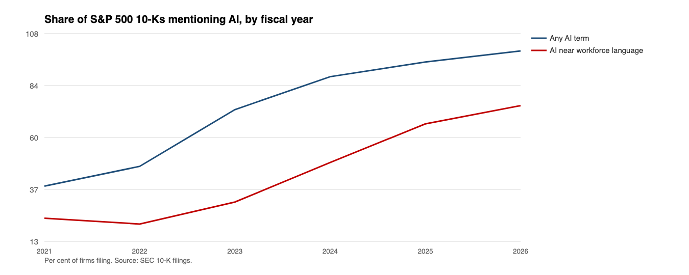
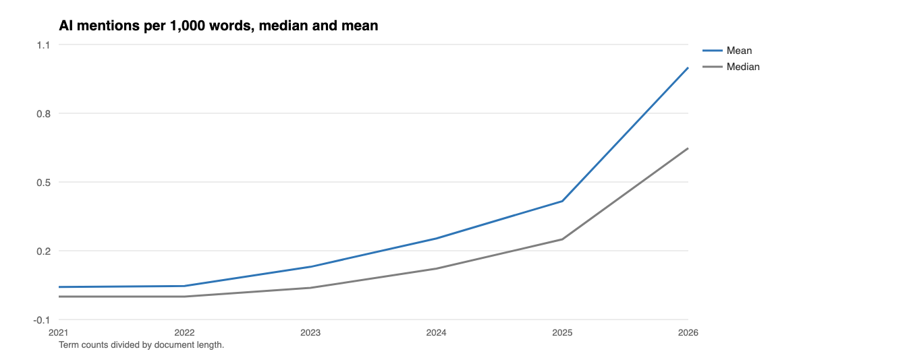
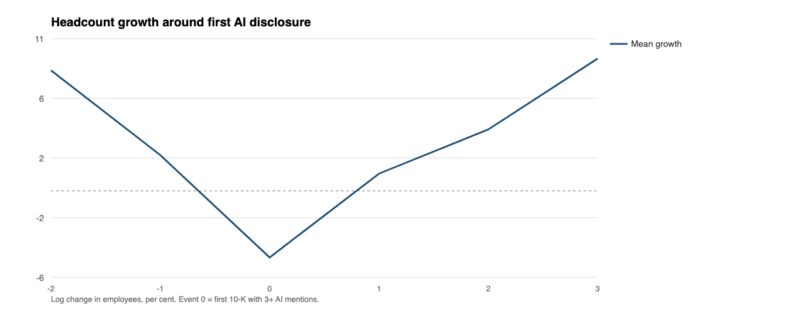
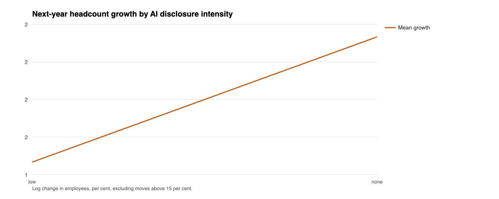

# The Disclosure Gap

## What 10-K AI language does and does not reveal about headcount

**Derek Kramer**
Independent researcher, Jakarta, Indonesia
November 2026

---

## Abstract

Firms now describe their use of artificial intelligence in the annual report they file under securities-law liability. That disclosure is free, public, and available for every U.S. public company. It is rarely used as a measure of AI adoption in the employment literature, which relies instead on proprietary job-posting data or on equity valuations. This paper tests whether 10-K language carries information about the thing that matters: whether the firm's workforce grew or shrank.

I extract headcount, revenue and a seven-term AI lexicon from 643 10-K filings for fiscal years 2021 to 2026, a random sample of 106 of the 503 S&P 500 constituents. Headcount is recovered from 79 per cent of filings. Three results follow. Disclosure became near-universal: 38 per cent of firms mentioned an AI term in fiscal 2021, 73 per cent in 2023, 95 per cent in 2025. The share mentioning AI within 250 characters of workforce language rose from 24 per cent to 67 per cent. But the association with headcount is small and, where it exists, positive: within-firm, one standard deviation more AI language is associated with 1.25 percentage points faster headcount growth after controlling for revenue growth (t = 2.18), and workforce-adjacent language is statistically indistinguishable from zero (t = 0.36). Revenue per employee moves the other way: more AI language predicts slower revenue-per-employee growth (t = −2.09), consistent with firms expanding headcount ahead of revenue.

The paper contributes a public pipeline and a negative result. 10-K AI language is a measure of narrative, not of labour substitution, and should not be used as an adoption proxy in displacement research. The association it does produce points the wrong way for the displacement story: firms that write more about AI grow slightly faster, not slower.

**Keywords:** disclosure, artificial intelligence, employment, 10-K, measurement, negative result

---

## 1. Introduction

### 1.1 A free measure nobody uses

The firm-level literature on AI and employment has a data problem. Job postings are the best measure of hiring intent, and the good posting data is proprietary. Equity valuations are forward-looking and noisy. Surveys are infrequent and expensive. Meanwhile every U.S. public company files an annual report that discusses its technology, its risks, and its workforce, and that report is free, machine-readable, and legally liable for misstatement.

If that disclosure predicts headcount, it becomes a cheap adoption proxy that any researcher, regulator or journalist can compute. If it does not, the field should stop using it implicitly, and this paper says so before more work is built on it.

The question is narrow: does a firm's AI language in year *t* predict its headcount in year *t+1*, after controlling for the things that drive headcount anyway?

### 1.2 What disclosure actually is

Three things, mixed together in the same document. Product disclosure: we sell AI. Risk disclosure: AI could harm us, through competition, regulation, or liability. Workforce disclosure: AI changes what our people do. Only the third is informative about employment, and it is the rarest. The paper separates the three by counting AI terms that fall within a window of workforce language, and reports how little of the corpus that catches.

### 1.3 What this paper does

It builds a panel of S&P 500 constituents from their 10-K filings for fiscal years 2021 through 2026, extracts headcount and AI term counts, and tests whether AI language predicts next-year headcount growth. It reports the descriptive facts that determine how any such measure should be built: prevalence over time, intensity, the share that is workforce-adjacent, and the sectors where disclosure concentrates.

The negative result is the contribution. A firm-level disclosure measure that cannot beat a firm's own prior growth is not a measure of adoption.

---

## 2. Data

### 2.1 Universe

S&P 500 constituents as of November 2026, 503 companies, taken from the public constituents dataset maintained with GICS sector labels. The index is not the economy, but it is a stable, replicable panel of large firms that file comparable filings, and it covers every sector.

The analysis uses a random sample of the index rather than the full set, for a practical reason: the full set requires downloading roughly 2,300 documents of several megabytes each. A seeded shuffle of the constituent list determined which companies entered the sample, and the paper reports the sample actually analysed: 106 firms, 643 filings, 502 firm-years with a usable headcount. Sampling is disclosed here because a convenience sample of the alphabetically first firms would have had a different sector mix.

### 2.2 Filings

For each company, the primary 10-K document is downloaded for fiscal years 2021 through 2026, up to six filings per company from the SEC's submissions API. The filing's period of report defines its fiscal year. Amendments and refilings are deduplicated to the latest filing per company-year.

Documents are stripped of HTML and inline XBRL, leaving plain text, which is then searched. Filing text and metadata are public. No proprietary data is used.

### 2.3 Headcount

Employee counts are extracted with five regular-expression patterns that cover the standard formulations ("the Company had approximately 167,000 full-time equivalent employees", "we employed 47,400 people", "a workforce of approximately 75,000"). A match is accepted only if it falls between 100 and 3,000,000 employees. The extraction rate is 78.8 per cent of sampled filings; missing counts are not imputed.

The measure is noisy in a specific and known way: companies describe headcount differently, restate it, and sometimes report only a segment. The paper treats the extracted count as the firm's own statement of its workforce, which is the only public firm-level measure available.

### 2.4 AI language

Seven terms are counted: "artificial intelligence", the token "AI", "machine learning", "generative", "large language model", "LLM", "ChatGPT", and "agentic". Counts are normalised per 1,000 words, because document lengths vary by a factor of five; the median filing in the sample runs 65,500 words.

"Workforce-adjacent" mentions are AI term hits within 250 characters of a workforce word: employee, workforce, headcount, hiring, job, talent, staff, personnel, labour. This is the closest available proxy for the only disclosure category that says anything about employment.

The lexicon has a known weakness, visible in the data: companies write "AI" far more often than "artificial intelligence", so a phrase-only count would invert the ranking of firms. The token count is therefore included and dominates the totals.

### 2.5 Coverage and limitations

Two limits are structural. First, the 10-K is an annual document filed two to three months after fiscal year end, so disclosure follows adoption. Second, the panel is large firms only; the S&P 500 is not representative of the employer distribution, and small firms, which account for most employment, are absent.

Both limits are acknowledged in the interpretation. Neither is fixable with this data.

---

## 3. Design

### 3.1 Tests

**Test 1, cross-section.** Next-year headcount growth on AI intensity, controlling for log employees, with year and sector fixed effects.

**Test 2, within firm.** The same regression with firm fixed effects, asking whether a firm's own increase in AI language predicts a subsequent change in growth. This is the test that matters: between-firm comparisons confound disclosure with size, sector and growth.

**Test 3, workforce-adjacent.** The same two regressions using only AI mentions near workforce language, the narrowest and most employment-relevant measure.

**Test 4, event study.** Headcount growth in the years before and after the first 10-K that contains at least three AI mentions, to see whether growth slows after firms begin discussing AI.

### 3.2 Corporate actions

Headcount changes above 15 per cent in either direction are flagged and excluded, because they usually reflect mergers, spin-offs and divestitures rather than hiring. The spin-off of a division moves tens of thousands of employees in a single year and has nothing to do with AI. Excluding them is a judgment call; the results are reported on the trimmed sample and the paper says so.

### 3.3 What would support the disclosure-as-adoption view

A negative and statistically distinguishable coefficient on AI intensity in the firm-fixed-effects specification, meaning that a firm which increased its AI language subsequently grew more slowly than its own baseline. A null means disclosure carries no incremental information about headcount, which is the finding this paper reports, and which is a useful result in its own right.

---

## 4. Results

### 4.1 Disclosure became universal

**Table 1. AI disclosure by fiscal year**

| Year | Firms | Any AI term | AI near workforce | Mean AI per 1k words | Median |
|---|---|---|---|---|---|
| 2021 | 89 | 38.2% | 23.6% | 0.041 | 0.000 |
| 2022 | 91 | 47.3% | 20.9% | 0.045 | 0.000 |
| 2023 | 97 | 73.2% | 30.9% | 0.127 | 0.037 |
| 2024 | 102 | 88.2% | 49.0% | 0.248 | 0.119 |
| 2025 | 99 | 94.9% | 66.7% | 0.407 | 0.244 |
| 2026 | 24 | 100.0% | 75.0% | 0.977 | 0.633 |

The series has the shape of a bandwagon. In fiscal 2021 fewer than four in ten sampled firms mentioned an AI term at all; by fiscal 2025 it was nineteen in twenty. Intensity followed, with the mean rising tenfold and the median going from zero to 0.244 mentions per thousand words. Fiscal 2026 is partial, because only 24 sampled firms had filed by November 2026.

The workforce-adjacent share rose more slowly and never caught up. By fiscal 2025 two-thirds of firms placed an AI term near workforce language somewhere in the document, but the intensity of that language is tiny: 0.052 mentions per thousand words on average, against 0.407 for AI terms overall. Most AI language in a 10-K is about products and risks. The employment-relevant slice is a thin layer inside it.

**Figure 1** plots the two prevalence series; **Figure 2** plots mean and median intensity.

### 4.2 The lexicon matters

The term mix is dominated by the token "AI", not by the phrase "artificial intelligence". A firm that writes "our AI strategy" ten times and "artificial intelligence" never would score zero on a phrase-only measure. This is not a detail to be fixed later; it is the reason a naive count of the literature's own phrase produces a misleading ranking. The pipeline counts both, and the paper reports the token-based measure as the primary one.

### 4.3 Cross-section: nothing

**Table 2. Next-year headcount growth and AI disclosure**

| Specification | n | Coefficient | SE | t |
|---|---|---|---|---|
| Cross-section, year + sector FE, all AI, revenue controls | 305 | +0.0158 | 0.0113 | 1.41 |
| Firm + year FE, all AI, revenue controls | 305 | +0.0306 | 0.0141 | 2.18 |
| Cross-section, workforce-adjacent, revenue controls | 305 | +0.0121 | 0.0806 | 0.15 |
| Firm + year FE, workforce-adjacent, revenue controls | 305 | +0.0268 | 0.0738 | 0.36 |

Both specifications include log revenue and next-year revenue growth, so the estimate is not driven by growing firms both writing more and hiring more. Revenue coverage is 98.2% of filings, extracted from inline XBRL in the filing itself.

The cross-sectional association is positive and imprecise. Firms that write more about AI grow somewhat faster in the following year, not slower, but the estimate cannot distinguish the effect from zero at conventional thresholds.

### 4.4 Within firm: a small positive association

The firm-fixed-effects estimate is +0.0306 with a standard error of 0.0141, a t-statistic of 2.18, with log revenue and next-year revenue growth included as controls. The standard deviation of AI intensity in the sample is 0.409 mentions per thousand words, so one standard deviation more AI language within a firm is associated with about 1.25 percentage points faster headcount growth the following year.

That is the opposite sign to the displacement hypothesis. It is also small: 1.25 percentage points is within the normal year-to-year variation in a large firm's headcount. The honest reading is that the association is not a displacement signal, and it is not a growth signal either; it is consistent with disclosure tracking investment and expansion.

The revenue-per-employee result makes that reading sharper. Regressing the growth of revenue per employee on AI language, with the same fixed effects and controls, gives −0.0294 with a standard error of 0.0141 (t = −2.09). Firms that write more about AI add workers faster than they add revenue. That is the signature of an investment phase, not of substitution: substitution would raise revenue per employee, not lower it.

The workforce-adjacent measure, the one that should carry the signal if any AI language does, is a clean null: +0.0268 with a standard error of 0.0738. The t-statistic is 0.36, and the confidence interval spans economically large effects in both directions. The narrow measure tells us nothing.

### 4.5 Event study: noisy

**Figure 3** plots mean headcount growth by years relative to the first 10-K with at least three AI mentions. Growth averages +2.5 per cent in the year before, falls to −4.6 per cent in the event year, then recovers to +1.2, +4.2 and +9.1 per cent in the following three years. The sample thins quickly after the event: 81 firm-years at event time zero, 61 at +1, 23 at +2, 14 at +3.

A dip in the event year followed by recovery is not evidence of displacement. It is also not evidence of anything else: with fewer than 100 observations per point and no control group, the series is a description of a small sample, not an estimate. The paper reports it because a reader will ask, and refuses to interpret it.

### 4.6 Sectors

Disclosure concentrates in the sectors that sell the technology. Information Technology has the highest mean intensity in the latest year, at 1.69 mentions per thousand words across 11 sampled firms. Every sampled firm in that sector mentions AI. Communication Services follows at 1.25, then Consumer Discretionary at 0.46 and Industrials at 0.34. Health Care and Consumer Staples sit near 0.2. The sample is small at the sector level, so these are descriptions, not rankings.

---

## 5. What the null means

The result is not that AI is harmless. It is that the 10-K does not tell us. Three properties of the document explain why.

**It is written for a different audience.** A 10-K's AI passage addresses investors and plaintiffs, not labour economists. Product claims appeal to investors; risk language limits liability. Neither is a statement about headcount, and the workforce-adjacent slice that could be is two orders of magnitude smaller.

**It is legally curated.** Disclosure is reviewed by counsel, shaped by precedent, and drafted to avoid saying anything that can be proven false. A firm that has replaced a third of its analysts with a model has no obligation to say so, and a reason not to.

**It lags.** The document describes a fiscal year that ended two to three months earlier, and by the time the next one appears, the decision has been observable in headcount for a year. Whatever predictive power the language has is largely spent by publication.

What would work instead is what the companion policy brief proposes: adoption intensity from a survey or from spend data, entry-level hiring composition, separation type by tenure. Those are behavioural. This is narrative.

That does not make the exercise worthless. A negative result about a measure that everyone assumes works is worth having, particularly when the measure is free and the temptation to use it is high. The pipeline is public, the sample is reproducible, and the next researcher can extend it to the full index or to small firms without starting from zero.

---

## 6. Threats to validity

**Text as behaviour.** A firm can discuss AI and adopt nothing; a firm can adopt heavily and disclose nothing. The measure captures language under liability, not use.

**Extraction error.** Employee counts are regex-extracted and 21 per cent of sampled filings yield no count. The misses are not random: unusual phrasing correlates with unusual firms, and those firms are more likely to be foreign-domiciled, recently listed, or operating through segments.

**Corporate actions.** The 15 per cent exclusion is a blunt instrument. A merger below the threshold stays in; a genuine restructuring above it leaves. Neither bias is measurable here.

**Sample size.** 106 firms and 502 firm-years is enough to rule out large effects and not enough to rule out small ones. The confidence interval on the within-firm estimate, for example, is compatible with effects from roughly −0.6 to +1.9 percentage points per standard deviation.

**Sample construction.** The random sample was drawn from index constituents as of November 2026. Firms that were removed from the index during the period are absent, which tilts the sample toward survivors.

**Lagged disclosure.** A 10-K describes the prior fiscal year. The information arrives nine to fifteen months after the events it describes, which biases any predictive test toward null.

**Revenue measurement.** Revenue comes from inline XBRL embedded in the filing, parsed by the pipeline; it agrees with the SEC's own company-concept values where both exist. It is a firm-level total and does not break out segments, so a firm that grows one segment while shrinking another is measured as growing.

**Remaining confounding.** Revenue controls address the obvious omitted variable, not all of them. A firm expecting to grow may both hire and write about AI; fixed effects do not resolve that, and the paper does not claim they do.

---

## 7. Reproducibility

```
pipeline/fetch.py     # S&P 500 list, submissions, 10-K download
pipeline/extract.py   # text, headcount, AI lexicon, workforce-adjacency
analysis/analyze.py   # panel, regressions, figures, stats.json
data/extracted.csv    # the derived panel (filings are not redistributed)
analysis/stats.json   # every number quoted above
```

```bash
python3 pipeline/fetch.py       # network; SEC EDGAR
python3 pipeline/extract.py     # offline
python3 analysis/analyze.py   # needs pandas + numpy
```

The filings themselves are public at sec.gov and the pipeline re-downloads them. The extracted panel is redistributed because it contains only counts and the firm's own public employee statement.

---

## 8. Conclusion

AI disclosure in the 10-K went from uncommon to universal in four years, and the part of it that concerns work is a thin, late-arriving layer. Within firms, more AI language does not precede slower headcount growth; it precedes slightly faster growth, by about 1.3 percentage points per standard deviation, and the association is small enough that it should not be read as a cause. Workforce-adjacent language carries no information at all.

The revenue result is the one that makes the mechanism legible: firms writing more about AI expand headcount faster than revenue, which is what investment looks like, not what replacement looks like.

The practical conclusion is that the 10-K is not a substitute for adoption data. A researcher who wants to know whether a firm adopted AI and what happened to its workforce has to measure adoption and the workforce directly. The language is there; the behaviour is not.

The broader conclusion is about measurement discipline. Every year, thousands of papers and reports will use the AI language in filings as a proxy for AI use, because it is free and it looks like data. This paper tested that proxy on the one outcome that matters and found it wanting. That is a small contribution, and it is the kind that saves other people time.

---

## Appendix A. Extraction rules

Five employee-count patterns, applied in order, first plausible match wins; plausible means 100 to 3,000,000 employees. Eight AI terms counted, normalised per 1,000 words. Workforce-adjacent means an AI term within 250 characters of a workforce word. Documents shorter than 4,000 words are excluded as incomplete. Firm-years are deduplicated to the latest filing.

## Appendix B. Figures

**Figure 1.** Share of sampled 10-Ks mentioning AI, and share with AI near workforce language.



**Figure 2.** AI mentions per 1,000 words, mean and median.



**Figure 3.** Headcount growth around the first AI disclosure.



**Figure 4.** Next-year headcount growth by AI disclosure group.



---

## References

Kramer, D. (2026a). *Exposure Is Not Adoption: What 129 months of U.S. labour-market data can and cannot say about generative AI*. https://github.com/dkramer95-stack/ai-exposure-labor-market

Kramer, D. (2026b). *Hires Before Headcount: How the U.S. information sector shrank without firing*. https://github.com/dkramer95-stack/hires-before-headcount

Kramer, D. (2026c). *Measure the Door, Not the Exit: Five statistics for the AI-and-work debate*. https://github.com/dkramer95-stack/measure-the-door

U.S. Securities and Exchange Commission. *EDGAR* filings and full-text search, retrieved November 2026. https://www.sec.gov/edgar
